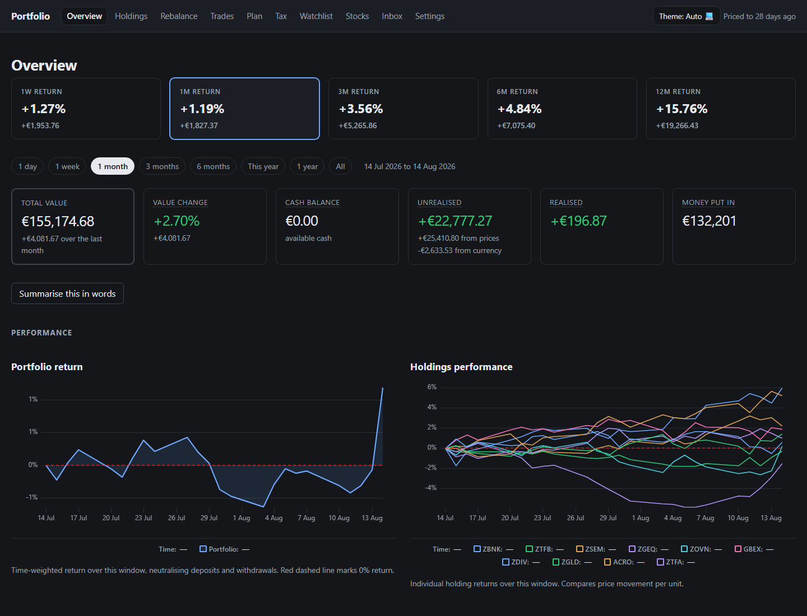
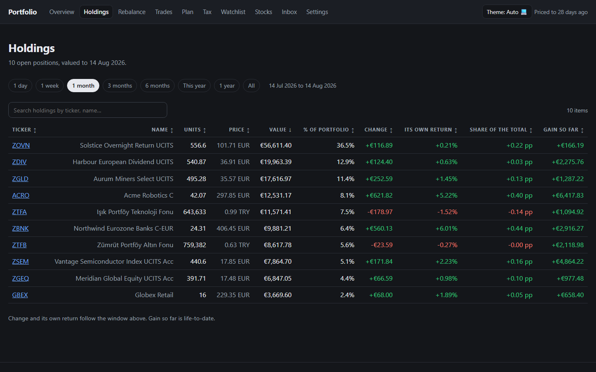
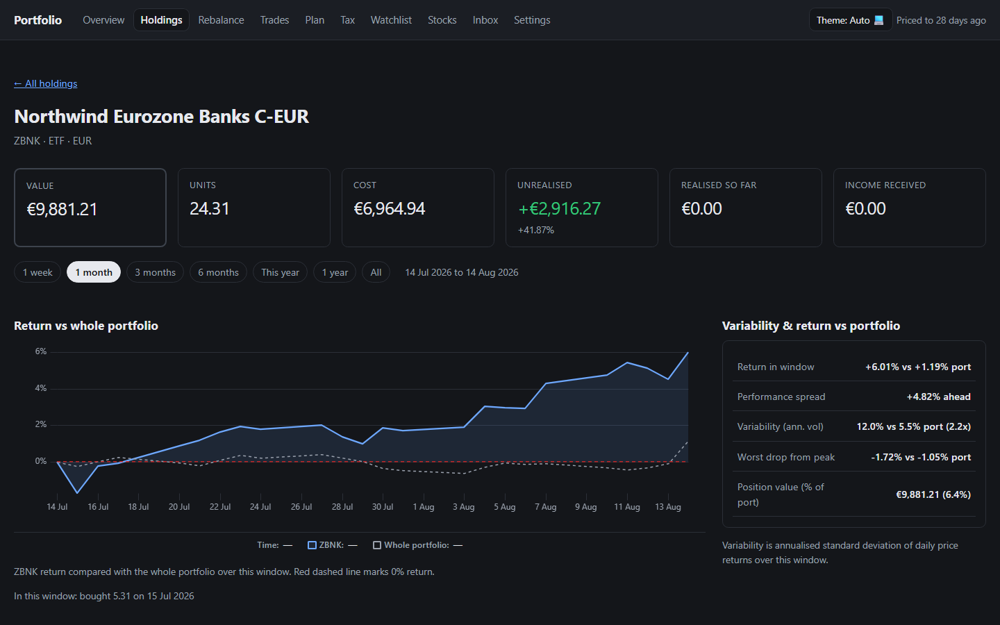
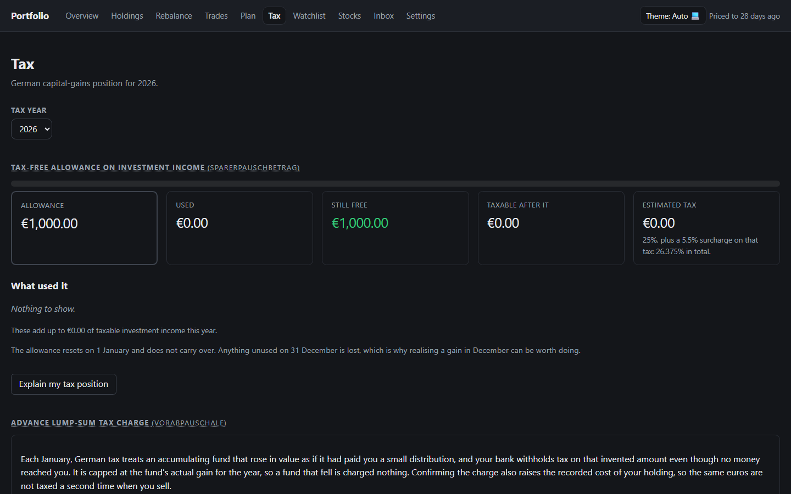
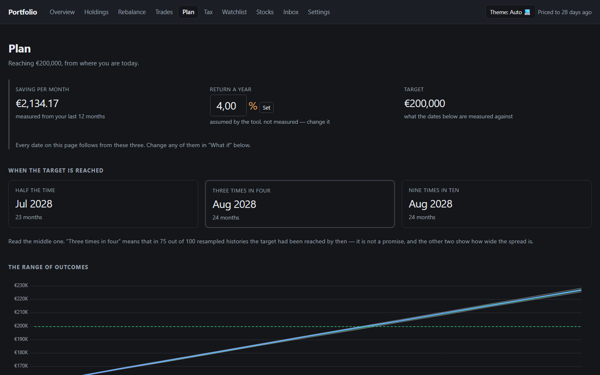
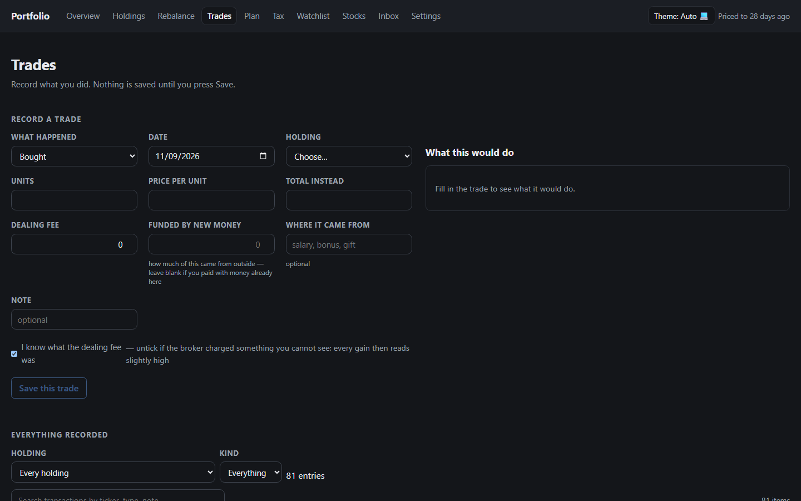
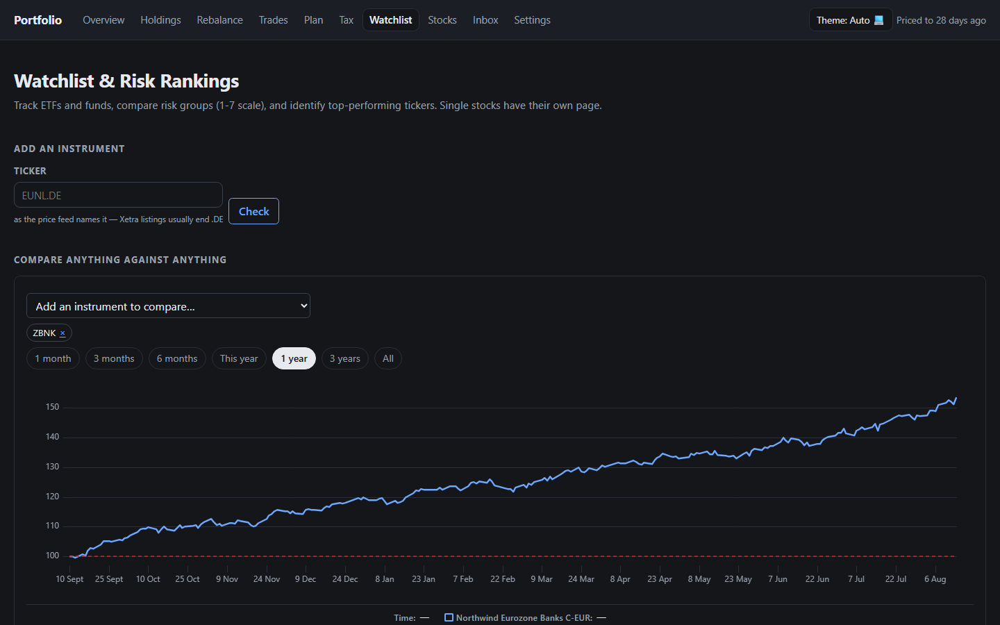
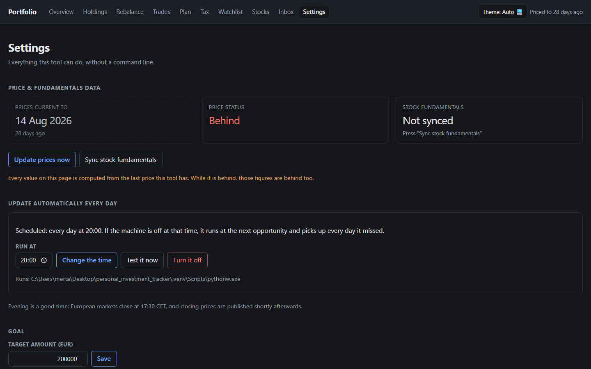
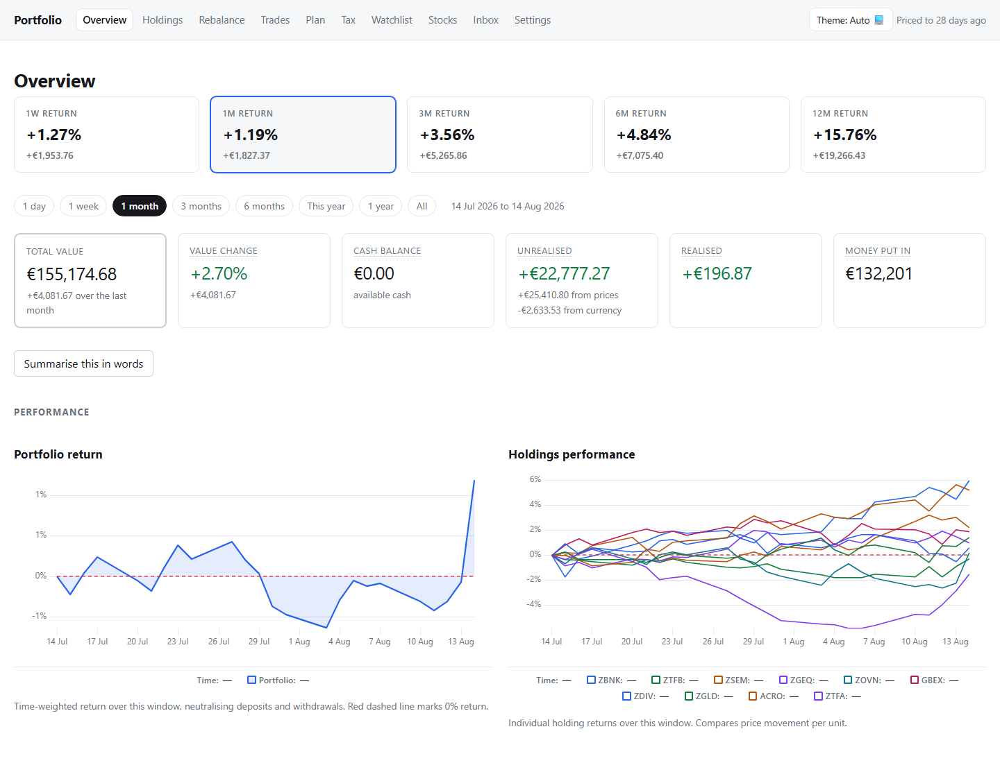

# Portfolio Tracker

A personal investment tracker for a German-resident investor holding a mixed
EUR/TRY portfolio, built around one idea: **a number is worthless without its
provenance.** Every figure the tool reports carries how it was derived, how stale
its inputs are, and what it is missing.

> **No real financial data is in this repository.** Everything committed under
> `data/example/` is generated by `scripts/make_example_data.py` from a fixed seed
> and describes fictional instruments. Real exports live in `data/`, which is denied
> by default in `.gitignore` and enforced by `scripts/check_no_pii.py` running as
> both a pre-commit hook and a CI job.

**Stack:** Python 3.12+, FastAPI, SQLite, `uv`; a plain HTML/CSS/ES-module front
end with uPlot vendored — no framework, no build step, no CDN. Tested with pytest,
ruff and mypy `--strict`.

## Screenshots

All screenshots below are taken against the synthetic example corpus in
`data/example/`. None of the figures are real.



| | |
| --- | --- |
|  *Holdings: value, own return and share of the total, per window* |  *One holding against the portfolio, with variability stats* |
|  *Tax: allowance used, Vorabpauschale forecast per fund* |  *Goal: when the target is reached, across stated returns* |
|  *Trade entry, with the consequence shown before saving* |  *Watchlist: instruments you do not own, indexed against one you do* |
|  *Settings: price updates, the scheduled daily task, the goal* |  *The same overview in the light theme* |


## Contents

- [Why it exists](#why-it-exists)
- [What it does](#what-it-does)
- [Quickstart](#quickstart)
- [Where the return came from](#where-the-return-came-from)
- [The tax charge nobody sends you a bill for](#the-tax-charge-nobody-sends-you-a-bill-for)
- [Everything routine lives on the page](#everything-routine-lives-on-the-page)
- [When you reach the target](#when-you-reach-the-target)
- [What a sale would cost, before you make it](#what-a-sale-would-cost-before-you-make-it)
- [What a fund is quoted in is not what it holds](#what-a-fund-is-quoted-in-is-not-what-it-holds)
- [The data is the interesting part](#the-data-is-the-interesting-part)
- [Honest limitations](#honest-limitations)
- [Known gaps](#known-gaps)
- [Architecture](#architecture)
- [Development](#development)
- [Licence](#licence)

---

## Why it exists

Portfolio trackers translate foreign-currency gains at *today's* exchange rate.
That is not what you earned.

The export this project is built on shows a Turkish fund position gaining
**+€2,105**. The actual gain in euros is **+€1,089**. The tool computes
`(current_price − open_price) × quantity ÷ today's spot` — the lira's decline over
the holding period simply does not appear. Solving for the implied EUR/TRY rate on
every lot returns the same ~55.25 whether the position was opened in July 2024 or
May 2026, a window in which the lira roughly halved.

So the headline number is not merely imprecise. It is structurally incapable of
showing currency effect, and it flatters every position in a depreciating currency.

This tracker separates the two:

```text
(1 + local return) × (1 + FX return) = (1 + EUR return)     exact, always
```

and reports both halves, so "my gold fund is up 97%" and "in euros I made 34%" can
both be true and visible at once.

## What it does

- **Reconstructs a transaction ledger** from a positions export that isn't one
- **FIFO tax lots** with German capital-gains treatment: Teilfreistellung,
  Vorabpauschale (§18 InvStG) including the cost-basis relief that stops it
  being taxed twice, loss pots (§20 VI EStG), Sparerpauschbetrag
- **Daily FX revaluation** of every non-EUR position, with local/currency return
  split out
- **ETF look-through**: economic exposure from published constituent lists, and
  the concentration that overlapping funds hide
- **Deposit-account interest accrual**, modelled so that capitalised interest reads
  as *return* rather than as new savings
- **TWR via unit accounting**, XIRR, volatility, max drawdown, and the return
  attributed to prices, currency, income and trading — Cariño-linked, so the
  parts sum to the whole exactly
- **A UI that leads**: charts of the portfolio and of each holding over time,
  trade entry with the tax consequence shown before you save, and daily price
  updates you schedule from a button — no command line in normal use
- **A goal target you set**, projected across stated returns and against the
  portfolio's own resampled history — never a single blessed date
- **A watchlist and peer comparison**: instruments you do not own, priced and
  measured against what you do hold at the same stated risk level; stock
  fundamentals with Value and Quality scores, dated snapshots, and a forward-return
  backtest that checks whether those scores predicted anything

Not a trading system. Nothing places orders. Output is a planning worksheet, not
tax advice — the bank's *Steuerbescheinigung* is authoritative.

## Quickstart

Once a database exists, the whole application is one command:

```bash
python run.py
```

That applies any pending schema updates, recomputes anything they left stale,
starts the server on a free port, waits until it actually answers, and opens the
browser. Everything else — recording a trade, updating prices, scheduling the
daily update, confirming an inferred dividend, reading the tax position — lives
on the page. Nothing in normal use requires a terminal.

### Try it with the example data

Everything under `data/example/` is fictional and generated from a fixed seed. To
build a database from it on a clean clone:

```bash
uv sync --extra api --extra ingest
uv run pt init-db
uv run pt import \
    --open   data/example/open.csv \
    --closed data/example/closed.csv \
    --account 1
uv run pt doctor
```

The corpus also ships published constituent lists for five of its funds, so
look-through has something to look through:

```bash
uv run pt look-through import -i ZGEQ -f data/example/holdings/ZGEQ.csv --as-of 2026-07-31
uv run pt look-through exposure --dim currency
```

`uv run pt --help` lists the rest of the CLI (`rebuild`, `fetch-prices`, `fetch-fx`,
`report`, `tax`, `reprice`, `sync-fundamentals`, `score-backtest`, …). In normal
use none of it is needed; the page does the same work.

### Why `run.py` does the preparation itself

It applies pending schema updates and rebuilds stale figures before opening the
browser. Those two matter more than they look. A program that knows what needs doing
and prints instructions instead has just moved its own work onto you. Both are
safe unasked — a migration adds structure, a rebuild recomputes tables that are
pure functions of the ledger — and neither can touch a trade, a price, or
anything you confirmed. **Everything that could stays on the page.**

The last step is the point too: opening the browser immediately races a cold
start and loses, which means a connection-refused page and a manual reload
every time.

`/` serves the application: plain HTML, CSS and ES modules with uPlot vendored
into the repository. No build step, no framework, no CDN — it works with the
network off, and a test fails the build if any asset ever references a remote
host. `/debug` still serves the older server-rendered page, which renders the
same figures without JavaScript and is the thing to open when the app itself
looks wrong.

The JSON lives under `/api/*`, with OpenAPI at `/docs`. Routes take a
**read-only** connection by default; the ones that write ask for a writable one
explicitly, so write access is something a route requests rather than something
it inherits. `POST /api/transactions/validate` takes the read-only connection on
purpose — that is what makes "the preview writes nothing" true by construction
rather than by review.

Three things the API does that are easy to get wrong:

| Rule | Why |
| --- | --- |
| **The total excludes cash** | `total_value_eur` is holdings plus deposit balances. Dividend income and sale proceeds sitting in the bank appear as `uninvested_cash_eur`, beside the total and never inside it — whether that money is still held is not knowable from the source data. |
| **A missing input is a refusal, not a zero** | `/api/tax/*` returns **409** when the year's Basiszins is unpublished. A zero would look like an answer, and answers get filed on an *Anlage KAP*. |
| **A stale price is reported, not hidden** | A five-day Bayram gap changes `valuation_status` and `price_stale_days`; it never changes the status code. Every response carries `as_of` and a `data_quality` block. |

```text
GET  /api/health/data          what can be trusted, and where it cannot
GET  /api/portfolio            headline total, cost basis, gain split by currency
GET  /api/positions            every open position
GET  /api/positions/{key}      one position, incl. why it disagrees with the export
GET  /api/allocation?dim=      asset_class | currency | account | sector | country
                    &basis=    quote (default) | look_through
GET  /api/look-through         which funds have a composition, and how old it is
GET  /api/exposure/concentration   underlying issuers, across funds and direct holdings
GET  /api/returns  · /series   TWR, XIRR, volatility, drawdown, attribution; the unit index
GET  /api/fx?quote=TRY         stored rates, in the one direction they are stored
GET  /api/accounts/deposits    deposit terms, including withholding at source
GET  /api/tax/allowance        with a mandatory out-of-scope block
GET  /api/tax/vorabpauschale   §18 InvStG forecast
GET  /api/pending              inferences that have not reached the ledger
GET  /api/incoming             what is in the drop folder, and what each file is
POST /api/incoming/import      import one dropped holdings file, against a fund you pick
POST /api/vorabpauschale/propose   compute the January charge and queue it
GET  /api/scenario/sell        what selling a holding today would cost in tax
GET  /api/scenario/harvest     what could be sold to use up this year's allowance
POST /api/transactions/validate  what a trade would do -- lots consumed, tax, allowance
POST /api/transactions         record it; recomputes before answering
GET  /api/transactions         the ledger, and what may be edited
GET  /api/tax/constants · PUT  the published rates, so a refusal has a remedy
GET  /api/updates              how current the prices are, and what recent runs did
POST /api/updates/run          fetch now, in the background
GET  /api/scheduler · POST · DELETE   the daily Windows task
GET  /api/admin/doctor         the integrity checks
POST /api/admin/recompute      throw away the derived layer and rebuild it
GET  /api/goal  · PUT          progress toward the target
GET  /api/goal/projection      when it is reached, across stated returns
GET  /api/watchlist · POST · DELETE   instruments followed but not owned; priced like holdings
GET  /api/peers/{key}          comparable instruments at the same risk level, and how they did
GET  /api/stocks/fundamentals  the watched stocks table, with Value and Quality scores
GET  /api/stocks/score-backtest   did a high score go with a better forward return?
POST /api/pending/{id}/confirm · /reject      decide an inference
POST /api/admin/rebuild        recompute the derived layer
```

Confirming is a real, irreversible write: it changes which lots a later sale
consumes and every return figure downstream. So the proposal's own arithmetic
sits next to the button, the amount is editable — you are usually the better
authority on money the source never recorded — and both figures are kept. A
rejection requires a reason, because it is a claim about what happened and in six
months the *why* is the only way to re-evaluate it. Nothing is recomputed
automatically: the response says `rebuild_required`, and rebuilding is a step you
take. The CLI (`pt flows confirm`) and the page call the same `core.inbox`
routing, so the two cannot come to mean different things.

## Where the return came from

The same question the per-position view answers, asked of the whole portfolio
over a period. On the example corpus:

```text
  asset prices             81.76%
  currency                -25.74%
  income                    0.00%
  trading                  -0.06%
  ------------------------------
  total                    55.97%
```

The holdings did far more than the euro return shows, and the lira took the
difference. A tracker reporting only 55.97% is not wrong — it is silent about
the larger of the two movements.

Getting the parts to add up is the hard part, and it is not a rounding
question. Chaining daily contributions naively gives **44.85%** against an
actual 55.97%: returns multiply, contributions add, and over 527 days the gap
is eleven percentage points on figures that are each individually correct.
[Cariño linking](docs/adr/0006-return-attribution-and-carino-linking.md) closes
it exactly — the measured residual is 6 × 10⁻²⁷ — and `/api/returns` reports
that residual anyway, because a reader has no other way to tell a smoothed
decomposition from an unsmoothed one.

`trading` is the term that could have been hidden. It is the remainder —
fills away from the closing price, fees, quantities that changed within a day —
and folding it into `asset prices` would report execution as stock selection
while every total still reconciled. `pt doctor` checks both identities: the
daily parts against the day's return, and the linked parts against a period
return computed independently by the unit series.

## The tax charge nobody sends you a bill for

German investors owe tax each January on a *deemed* distribution from every
accumulating fund that rose — the **Vorabpauschale**, §18 InvStG. No money
arrives. The bank withholds anyway.

```bash
uv run pt vorabpauschale forecast --year 2025    # compute and print
uv run pt vorabpauschale propose  --year 2025    # store it, queue it for review
uv run pt vorabpauschale check                   # relief carried on open lots
```

The half that matters is what happens **years later**. A Vorabpauschale is taxed
when charged; if it is not then deducted from the gain when the fund is sold,
the same euros are taxed twice. Both figures look correct in isolation, nothing
reconciles them, and the overpayment surfaces in a number nobody can trace.

So confirming a charge raises the cost basis of the lots it applies to
(`§ 20 Abs. 1 Nr. 3 Satz 5 EStG`), the relief travels with the units into each
disposal, and `pt doctor` checks that every booked euro is either sitting on an
open lot or has been claimed — `VAP_RELIEF_LOST` is the finding, and it is an
error rather than a warning.

Two things it deliberately does not do. It does not credit cash: the ledger row
moves no money, and the cash engine, unit series and attribution all ignore it
by type. And it does not book itself — the Basiszins is published once a year by
the Bundesfinanzministerium and the Teilfreistellung follows each fund's
*Anlagebedingungen* rather than its holdings, so this is the one inference whose
output goes on a tax return and a person confirms it.

## Everything routine lives on the page

The command line is for the initial bulk load. After that, `run.py` is the whole
interface — it migrates and rebuilds itself, and the page carries the controls:

| On the page | What it does |
| --- | --- |
| **Drop folder** | Put issuer holdings files in `data/incoming/`. The page says what it found in each — how many holdings, what the weights sum to, which columns it matched — and you pick the fund and publication date. Imported files move to `imported/` rather than being deleted. |
| **Vorabpauschale** | Compute the January charge for a year; it queues into the review inbox like every other inference. |
| **Awaiting review** | Confirm or reject inferred contributions, distributions, interest and tax charges, with the arithmetic beside the button. |
| **What would selling cost?** | Price any holding, whole or partial, against today's close. |
| **Goal** | Set the target; override the monthly contribution the projection assumes. |

Nothing is imported or booked without you choosing it. The detection in the drop
folder is a *proposal* — a holdings file does not reliably say which fund it
belongs to, and attaching one issuer's constituents to the wrong fund would
corrupt every exposure figure without erroring anywhere.

## When you reach the target

The goal projection assumed **no investment return at all** — falsifiable, but
wrong in a known direction for a portfolio that compounds. It now answers two
ways, and neither is a forecast:

```bash
uv run pt goal show                          # contributions only, no return assumed
uv run pt goal project --target 250000       # with growth in it
```

```text
  IF the portfolio returns...      then the target is reached
       0% a year                  2028-02-14
       4% a year                  2027-12-14
       8% a year                  2027-11-14

  For scale: this portfolio has actually returned 23.7% a year so far.
  That is history, not a rate to plan on.
```

**The tool never picks a row.** There is no single projected date in the output,
because that would be a number nobody chose presented as one somebody did — the
spread between the rows *is* the answer. Here it happens to be narrow, which
tells you contributions dominate and the return assumption is not the thing to
worry about.

Below the table, a block bootstrap resamples the portfolio's *own* daily returns
in month-long blocks. That one is a model, labelled as one, and its sample
window is printed beside every figure it produces — because resampling a past
assumes the future is drawn from the same distribution, and that assumption is
the entire content of the answer.

This is deliberately **not** the Monte Carlo cone the original design specified
and [ADR 0003](docs/adr/0003-scope-cut.md) cut. The difference is where the
numbers come from: an assumption you state outright, or a return this portfolio
actually made. Nothing is invented. See [ADR 0009](docs/adr/0009-goal-projection-without-a-forecast.md).

## What a sale would cost, before you make it

Every other view reports what happened. This one answers the question you ask
*before* acting:

```bash
uv run pt scenario harvest              # how much allowance is left, and what could fill it
uv run pt scenario sell -i ZGEQ         # what selling this would realise, and cost
```

```text
Selling 391.7074 of ZGEQ (the whole holding) at 17.4800 EUR as of 2026-08-14

  gross gain               EUR       977.48
  less Vorabpauschale      EUR        23.18   (already taxed)
  less Teilfreistellung    EUR       286.29
  taxable gain             EUR       668.01

  allowance left before    EUR       803.28
  allowance left after     EUR       135.27
  TAX THIS SALE ADDS       EUR         0.00
```

The **marginal** figure is the point: the same gain costs nothing or 26.375%
depending only on what the year's allowance has already absorbed, so a per-sale
tax number without the year around it isn't an answer. It also shows which lots
FIFO would consume — selling "half" a position realises the *oldest* half, which
on a holding built up over two years is a very different gain.

Two rules it holds to. **Today's prices only** — there is no assumed-return
slider and no Monte Carlo cone, because a number with the shape of a forecast
and none of the substance is worse than no number ([ADR 0008](docs/adr/0008-tax-scenarios-without-forecasting.md)).
And **nothing is written**: the routes take the read-only connection and a test
asserts it, because a scenario that left rows behind would be indistinguishable
from a decision afterwards.

`pt scenario harvest` lists; it does not recommend. Which holding to sell
depends on what you want to keep owning, which the tool knows nothing about.

## What a fund is quoted in is not what it holds

`dim=currency` on the quote basis answers a question nobody asked: which
currency each instrument is *listed* in. For a portfolio of UCITS ETFs that is
almost always EUR, whatever the funds actually own. On the example corpus every
instrument is euro- or lira-quoted, and opening five of them up moves roughly
€37,000 of "euro exposure" into seven other currencies.

Constituent lists come from the issuer, as files, because there is no feed and
no issuer promises its format will exist next quarter:

```bash
uv run pt look-through import -i ZGEQ -f data/example/holdings/ZGEQ.csv --as-of 2026-07-31
uv run pt look-through exposure --dim currency     # both answers, side by side
uv run pt look-through concentration --top 20      # who you actually own
uv run pt look-through list                        # what has no composition
```

The import prints the three decisions that could make a good file into a wrong
answer: which column it read as the weight, what unit it concluded it was in,
and what the weights summed to before anything scaled them. Weights are stored
exactly as published and divided by their own recorded sum on read, so a file
that sums to 0.9985 is scaled visibly rather than quietly.

Concentration is the part no instrument-level view can produce. A company held
through three funds *and* outright is one exposure, and only the constituent
lists show it — on the example corpus `Acme Robotics C` is €12,531 held directly
and €13,300 in total.

Every figure carries which of four bases it rests on: a published constituent
list, a **declared** `economic_currency` (an assertion, not evidence), a direct
holding that is its own exposure, or a fund with none of those — still reported
on its wrapper, and named. A 50%-covered breakdown and a fully covered one look
identical without that block, and the second is a much stronger claim.

Exposure never touches the return decomposition. The local/currency split in
`/api/returns` is computed from the rate each position was actually valued at
and is an exact identity; look-through is an estimate of what the portfolio is
exposed to next. Two numbers, two questions.

`uv run pt doctor` checks the derived data against the identities it must
satisfy — market value is quantity times price, the gain split's parts sum to
the whole, contributions in the daily series match contributions in the ledger.
Errors are bugs; warnings are gaps in the source that bound what the numbers
mean. Three of those checks caught real bugs during development, including a
1326% return produced by five contributions that fell off the valuation grid.

The goal target is stored, not compiled in — the €120,000 figure in the original
brief was invented by the document that proposed it, and a number nobody chose has
no business driving a progress bar. Its projection counts contributions and **no
investment return at all**, and refuses to give a date when there is under six
months of history to measure a rate from.

## The data is the interesting part

The source is an Investing.com **positions view**, not a transaction log. Every row
says `BUY`, including the closed ones. There are no sells, no fees, no dividends, no
transaction IDs. Reconstructing a ledger from it is most of the work, and the
parsing surface is genuinely hostile:

| Property | Example | Why it bites |
|---|---|---|
| Quantities abbreviated above 100,000 | `376.9K` | Irreversible precision loss — 376,900 ± 50 |
| …but recoverable from market value | `148.76K` → **148,756** | The printed value was wrong by 4 |
| Mixed currency in one column | `€ 10,697.10` / `₺236.32K` | `€` takes a space; `₺` never does |
| P/L always in EUR, even for TRY rows | `€ 2,105.37` | Translated at today's spot — no FX effect |
| Sign before the symbol | `-€ 2,087.72` | Not `€ -2,087.72` |
| Quoting only when a comma appears | `"€ 10,697.10"` vs `€ 507.08` | |
| Money with no decimals | `€ 122` | Means €122.00 |
| Ambiguous US dates | `03/05/2026` | A locale-sensitive parser shifts it two months |
| Trailing U+00A0 on every name | `Alphabet C\xa0` | Breaks exact-match joins |
| UTF-8 BOM, CRLF | | `utf-8-sig`, or the first header is `Name` |
| One lot split across both files | open 125.726 + closed 70.5778 | The real buy was 196.3038 |
| One lot, two disposals, neither file listing it as open | 244.7586 + 244 | The real buy was 488.7586 |

That last pair is the one that silently corrupts everything downstream. Process the
two files independently and FIFO gets lots that are too small, so every subsequent
taxable gain is wrong — with no error anywhere to notice.

The importer emits a report making all of this explicit: which quantities were
recovered and how, which lots were reconstructed from which rows, which identity
checks passed, and what is still missing.

## Honest limitations

Stated here rather than buried, because they bound what the numbers mean:

1. **No fee data exists in the source.** Cost basis is understated by every purchase
   fee, so computed taxable gains are biased high. Trades carry `fees_known = 0` so
   the bias is visible rather than assumed away.
2. **Distributions are recovered, not recorded.** The export has no income rows at
   all, which booked every ex-date price drop as a loss. Distributions are now
   derived from the price feed's per-share amounts against the quantity held on the
   ex-date — but nothing reaches the ledger without confirmation, and the feed
   publishes *gross*, so withholding is stored as unknown rather than as zero.
   Every price update scans the last 90 days and puts new distributions, and any
   deposit interest that has fallen due, in the inbox. A dividend already typed in
   from a statement is recognised and not proposed again.
3. **External cash flows are inferred.** The source records no deposits, so a
   purchase not funded by a prior sale implies a contribution, which the tool
   proposes and the owner confirms. XIRR is therefore labelled
   `"reliability": "low"`; TWR via unit accounting is the number to trust.
4. **Look-through is only as complete as the files you load.** Economic exposure
   is computed from published constituent lists; a fund with none is still
   reported on its wrapper's own currency. Every response says which share rests
   on evidence, and `pt doctor` warns about the rest. A composition is also a
   snapshot: nothing refreshes it, and `LOOK_THROUGH_STALE` fires after 180 days.
5. **Turkish mutual funds are not on mainstream price feeds.** They are priced
   from TEFAS, the official register, through the JSON endpoint its own fund
   pages call. The republisher used before started blocking automated requests
   in September 2026, and TEFAS's older endpoint was removed in the same site
   rebuild. The endpoint is undocumented, so the manual CSV path, which reads
   TEFAS's own export format, stays a co-equal requirement rather than a fallback.
6. **Yahoo Finance is not a reliable source for German-listed ETFs.** In
   September 2026 it dropped over a hundred Xetra symbols, publishes ETF daily
   bars a day late, and served USD histories against EUR listings for roughly
   half of the funds in the comparison set. German ETFs and stocks are therefore
   priced from onvista's public Xetra feed, with Yahoo kept only as a fallback,
   and `pt reprice` compares a source's history against what is stored and
   replaces it where it disagrees. Both feeds are undocumented and can change
   without notice; the manual CSV path is what remains when they do.

## Known gaps

Things a visitor will hit, listed rather than discovered:

- **XIRR is approximate**, and says so. Contributions are inferred from
  purchases, so their dates are the days money was *invested*, not the days it
  arrived. TWR via unit accounting is unaffected and is the number to trust.
- **The FX *return* split is still quote-based**, and deliberately. A EUR-quoted
  S&P tracker shows zero currency contribution in `/api/returns` because it was
  genuinely valued in euro; the dollar risk it carries appears under exposure
  instead. Reconciling the two would mean modelling a return that was never
  observed. See [ADR 0005](docs/adr/0005-look-through-exposure.md).
- **`trading` in the return attribution is a remainder**, so it silently absorbs
  any future modelling error as well as the real thing. Its size is the
  diagnostic: the API raises a caveat above 5% of the total return, and the
  example corpus is pinned below 1%.
- **Concentration merges on identifiers where files supply them**, and on names
  otherwise. Two issuers publishing the same company under different names with
  no ISIN will not merge, so the figure understates. That is the safe direction.
- **Cost basis for lira lots stays estimated.** The export prints open prices to
  three or four decimals and there is no lossless route to the true figure, so
  `basis_quality` records the doubt rather than hiding it.

## Architecture

```text
importers/investing_com/   parse -> normalize -> reconcile -> import   (pure, then DB)
core/fx.py                 the only currency conversion in the codebase
core/lots.py               FIFO; freezes EUR cost basis at acquisition-date FX
core/valuation.py          daily revaluation on the TARGET2 grid
core/returns.py            unit accounting, TWR/XIRR, local-vs-FX decomposition
core/attribution.py        return split by source; Cariño-linked, residual zero
core/vorabpauschale.py     the January charge: proposed, booked, and relieved on sale
core/scenario.py           price a sale before making it; today's prices, never a forecast
core/projection.py         when the goal is reached, and what that answer depends on
core/look_through.py       economic exposure and concentration; four labelled bases
core/cash.py               running bank balance; infers the contributions nobody recorded
core/accounts.py           deposit accrual; interest reads as return, never as savings
core/tax.py                German engine; zero FX arithmetic, zero currency tests
core/interest.py           accrued-but-unpaid interest, proposed for review
core/inbox.py              what confirming an inference means, for every front end
core/goal.py               target and projection; contributions only, no assumed return
ingest/dividends.py        distributions, proposed for review rather than booked
ingest/look_through.py     issuer holdings files; refuses rather than guesses a unit
ingest/providers/          prices: onvista (Xetra, primary for .DE), yfinance (fallback, US),
                           TEFAS (Turkish funds), manual CSV; one contract, one fallback map
core/ledger.py             writes a trade somebody typed; freezes its EUR leg
core/glossary.py           German statutory terms, in English, German kept alongside
core/locking.py            one update at a time, across processes; refuses, never queues
core/watchlist.py          instruments you do not own but want measured
core/peers.py              comparable instruments at the same stated risk level
core/universe.py           the comparison catalogue; loaded on request, never on startup
core/score_snapshots.py    dated Value/Quality scores, so they can be checked later
core/score_backtest.py     rank correlation, bucket returns, hit rate vs a benchmark
jobs/update.py             fetch what is missing, then recompute; unattended
jobs/windows_task.py       registers the daily update with Task Scheduler, from the page
api/transactions.py        record a trade -- and say what it will do before you save it
api/admin.py               the maintenance that used to be CLI-only
api/static/                the app: plain HTML/CSS/ES modules, uPlot vendored, no build
api/render.py              the server-rendered page it replaced, kept at /debug
```

Three currency rules hold everywhere:

1. FX is stored one direction only — quote units per 1 EUR — enforced by a `CHECK`
   constraint. Conversion is *always* division. There is no multiply-path to get
   backwards.
2. Native currency is authoritative; EUR is a stored derivation carrying the exact
   rate and as-of date used. Prices are never stored in EUR.
3. Conversion happens in exactly three places. `returns.py`, `tax.py` and the API
   contain none.

Design decisions and the reasoning behind them are in [`docs/adr/`](docs/adr/).

## Development

```bash
uv sync --all-extras --dev
uv run pytest -q                     # ~970 tests, incl. golden fixtures under tests/golden/
uv run ruff check . && uv run ruff format --check .
uv run mypy                          # strict
uv run python scripts/check_no_pii.py --all
```

CI runs the same five steps, plus a history scan for anything that was ever
committed and later deleted. `pre-commit install` wires the PII guard into every
commit locally.

## Licence

[PolyForm Noncommercial 1.0.0](LICENSE) — free for noncommercial use. Not an
OSI-approved licence, so GitHub displays it as "Other".
